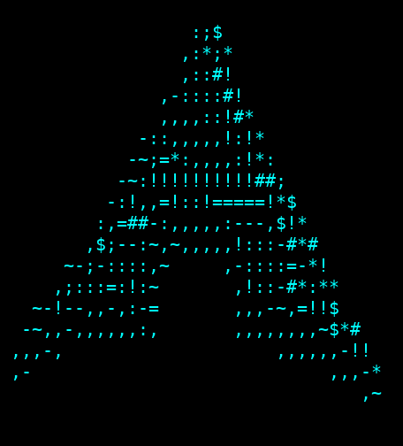
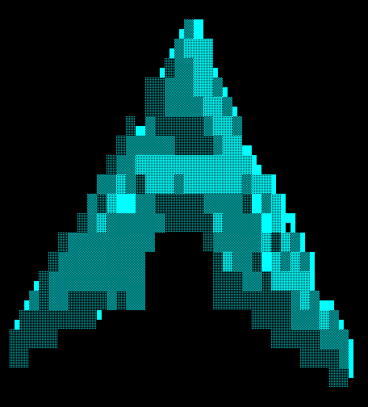

# fetch

A donut.c-inspired fetch tool that spins your distro logo in 3D with live-updating system info.


Takes any ASCII/Unicode distro logo, turns each character into a point cloud
based on its visual density, and renders it as a rotating 3D relief with
Blinn-Phong shading. System info is gathered natively with no external
dependencies. Works on Linux and macOS.

Based on [gentoo.c](https://github.com/areofyl/gentoo.c). This is a Rust port
of [areofyl/fetch](https://github.com/areofyl/fetch): same flags, config
format and output, rendered frame for frame the same as the C original.

## Build & run

```
cargo build --release
./target/release/fetch
```

`make` does the same. Needs a Rust toolchain (stable, 1.82 or newer).

Press any key to stop. The keypress passes through to the shell, so it
works as a startup fetch. Ctrl-C works too (but is less cool). Click and
drag the logo to rotate it by hand, release to fling it spinning.

## Install

```
sudo make install
```

`PREFIX=~/.local make install` if you don't want it system-wide, or
`cargo install --path .` to put it in `~/.cargo/bin`.

## Packages

The packaging files (`debian/`, `fetch.spec`, `nix/`, `flake.nix`) build this Rust port with Cargo,
but they have not been test-built yet. The distro packages published for the C project still ship the C version. Otherwise build from source as above.

## Logos

Custom logos: [docs/custom-logos.md](docs/custom-logos.md)

By default it auto-detects your distro and grabs the logo from fastfetch
(if installed) with its original per-character colors preserved. Works with
any of fastfetch's 500+ distro logos!

You can also specify one directly:

```
./fetch -l arch
./fetch -l NixOS
./fetch -l asahi
```

Or drop a custom logo in `~/.config/fetch/logo.txt`:

```
# distro: gentoo
         -/oyddmdhs+:.
     -odNMMMMMMMMNNmhy+-`
...
```

Some logos are built into the binary and need no fastfetch:

| Logo | Used when |
|------|-----------|
| SingularitySYS (a ringed black hole) | the distro ID is `singularity`, or `-l singularity` |
| Gentoo | fallback when nothing else matches |

A `~/.config/fetch/logo.txt` always wins over a built-in logo.

## System info

All system info is gathered natively. No fastfetch or neofetch needed:

- **OS** - `/etc/os-release`
- **Host** - `/proc/device-tree/model` or `/sys/class/dmi/id/product_name`
- **Kernel** - `uname()`
- **Uptime** - `/proc/uptime`
- **Packages** - emerge, pacman, dpkg, rpm, xbps, apk, flatpak, brew, nixpkgs
- **Shell** - parent process detection (not just `$SHELL`)
- **Display** - per-connector DRM enumeration (multi-monitor): active resolution and refresh rate from the CRTC mode, monitor name and physical size from EDID, built-in vs external
- **WM** - process scanning + DE-to-WM mapping
- **Display Manager** - process scanning
- **Theme/Icons/Font** - `~/.config/gtk-3.0/settings.ini`, `~/.gtkrc-2.0`, and Qt (`qt6ct`/`qt5ct`, `~/.config/kdeglobals`) on Linux, `defaults read` (macOS)
- **Cursor** - `~/.config/gtk-3.0/settings.ini` (Linux only)
- **CPU** - `/proc/cpuinfo`, device-tree (Apple Silicon), or `sysctl` (macOS)
- **GPU** - DRM + `lspci` for full names (Linux), `system_profiler` (macOS)
- **Memory/Swap** - `/proc/meminfo` (Linux), `vm_stat` (macOS)
- **Disk** - `statvfs()` + `/proc/mounts` (Linux), `getmntinfo` (macOS) – supports multiple mount points via config
- **Battery** - `energy_now/energy_full` plus `model_name` (Linux), IOKit (macOS)
- **Power Profile** - `/sys/firmware/acpi/platform_profile`, fallback `powerprofilesctl get 2>/dev/null` (Linux)
- **Local IP** - `getifaddrs()`

Stats like memory, battery, and uptime update in real-time while the logo spins.

## Config

Full reference: [docs/configuration.md](docs/configuration.md)

Create `~/.config/fetch/config` to customize:

```
# fields – list to show, in this order
# remove or comment out to hide
os
host
kernel
uptime
packages
shell
display
wm
displaymanager
theme
icons
font
cursor
terminal
cpu
gpu
memory
swap
disk
ip
battery
powerprofile
locale
colors

# separators (blank line between groups)
# ---

# custom static fields
# custom_Pronouns=he/him
# custom_Website=example.com

# extra disks (add more mount points)
# disk=/home
# disk=/data

# appearance
# label_color=magenta   (red, green, yellow, blue, magenta, cyan, white)
# separator=─           (character for the title separator)
# shading_mode=ascii    (ascii, or opt into blocks / sextants)
# shading=.,-~:;=!*#$@  (characters for 3D shading, supports UTF-8)
# box=0                 (adds a box around the system-data, 0 = off, 1 = on)

# logo colors (override distro defaults)
# logo_outer=magenta    (extruded side color)
# logo_inner=white      (front/back face color)

# 3d
# light=top-left        (top-left, top-right, top, left, right, front, bottom-left, bottom-right)
# spin=xy               (x, y, or xy)
# speed=1.0             (rotation speed)
# size=1.0              (logo scale, e.g. 2.0 for double size)
# depth=1.0             (3D extrusion depth, e.g. 3.0 for chunkier look)
# height=36             (override render height in rows)
# v_alignment=top       (top, center, bottom)
# h_alignment=left      (left, center, right)
```

## Options

| Flag | Description |
|------|-------------|
| `-l`, `--logo <name>` | Use a logo from fastfetch by name |
| `--rotate-x` | Lock rotation to X axis only |
| `--rotate-y` | Lock rotation to Y axis only |
| `-s`, `--speed <float>` | Speed multiplier (default 1.0) |
| `--size <float>` | Scale the logo (e.g. 2.0 for double size) |
| `--depth <float>` | Scale the 3D depth (default 1.0) |
| `--height <n>` | Override render height in rows |
| `--box` | Draw a border box around the info block |
| `--no-info` | Just the logo, no system info |
| `--no-color` | Disable coloring |
| `--frames <n>` | Stop after n frames |
| `--shading-mode <mode>` | `ascii` (default), or opt into sub-cell blocks with `sextants` (2x3) or `blocks` (2x2) |
| `--shading-chars <str>` | Custom shading ramp, supports UTF-8 |
| `-h`, `--help` | Show help |
| `-V`, `--version` | Show version |

CLI flags override config file settings.

## Shading modes

Full reference: [docs/shading-modes.md](docs/shading-modes.md)

ASCII is the default. The sub-cell modes are opt-in, and trade the donut.c look
for a silhouette that lands on a fraction of a cell instead of snapping to the
character grid.

| `ascii` (default) | `blocks` | `sextants` |
|:---:|:---:|:---:|
|  |  |  |
| brightness mapped onto `.,-~:;=!*#$@`, one character per cell | coverage sampled 2×2, edges on quadrants | coverage sampled 2×3, edges on block sextants |

`sextants` needs a terminal that draws the Symbols for Legacy Computing block
(kitty, Ghostty, foot and WezTerm do it themselves, so the font does not matter);
`blocks` works anywhere with a UTF-8 locale.

Same logo, same frame, same terminal palette in all three.

## Contributing

PRs are welcome! If you want to add a feature, fix a bug, or package fetch for
your distro, go for it. I try to keep the codebase small and easy to understand,
so smaller PRs are easier to merge than big ones.

If you want to chat about ideas before writing code, reach out on
[Reddit](https://www.reddit.com/user/areofyl) or open an issue.

## How it works

For a deep dive with visuals and code, see the [full blog post](https://asdesai.com/blog/how-fetch-works/).

1. **Logo loading** – reads ASCII/Unicode art from `~/.config/fetch/logo.txt` or
   grabs a distro logo via fastfetch. ANSI color codes are parsed and preserved
   per-character.

2. **Heightmap** – each character gets a weight based on visual density (`@` is
   heavy, `.` is light, `█` is full, `░` is thin). The weight becomes a Z height,
   turning the flat logo into a 3D relief map. Logos with low height variance
   (uniform characters) get their depth auto-scaled so they don't look flat.

3. **Point cloud** – the heightmap is sampled into 3D points. Interior cells get
   multiple Z layers for a solid extrusion, edge cells get only front and back
   faces to keep outlines clean.

4. **Surface normals** – computed from the height gradient at each cell using
   finite differences, giving each point a direction for lighting.

5. **Rotation + projection** – every frame, all points are rotated around X/Y
   axes, then perspective-projected onto the terminal grid with a z-buffer to
   handle occlusion.

6. **Shading** – Blinn-Phong lighting (diffuse + specular) gives every visible
   point a brightness, which maps onto the `.,-~:;=!*#$@` ramp, one character
   per cell. `--shading-mode sextants` or `blocks` instead samples coverage
   finer than the character cell – 2×3 or 2×2 – and each cell picks whichever
   glyph carries the right amount of ink: a shade block (`░▒▓█`) where the cell
   is filled, a partial block where the silhouette cuts through it. So an edge
   lands on a fraction of a cell instead of snapping to the character grid.

   Logos that ship their own colors keep them. The rest are two-toned by
   surface: front and back faces in `logo_inner`, extruded sides in
   `logo_outer`.

7. **Rendering** – the entire frame is written in a single `write()` syscall to
   avoid flicker. System info is displayed alongside the animation and
   fast-changing fields (uptime, memory, swap) update live every second.

Single file C, no dependencies beyond libm.
