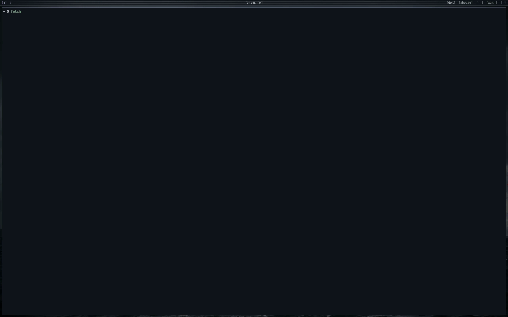
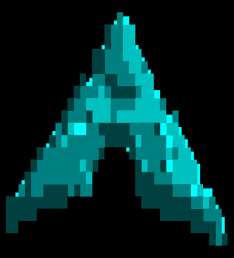

# fetch

**A Rust port of [areofyl/fetch](https://github.com/areofyl/fetch)**, the
donut.c-style system-info tool that spins your distro logo in 3D, with a few
changes of its own.



<sub>The recording is from the original project; this port renders the same frames.</sub>

fetch turns every character of an ASCII/Unicode logo into a column of points
whose height follows the character's visual density, then draws the result as a
rotating relief with Blinn-Phong shading, next to live system info. It reads
everything natively (no fastfetch or neofetch needed) and the only crate it
depends on is `libc`.

## What's different from upstream

This is a port, not a fork of the C source: the program was rewritten in Rust
module by module. On Linux the output is the same as upstream's v2.3.0, which I
checked by running both binaries side by side and diffing the frames byte for
byte, across options, config files, logos and terminal sizes. What changed:

| | |
|---|---|
| **Language** | Rust instead of one C file. Safe code throughout apart from a few clearly marked `libc` calls (terminal, DRM, `getifaddrs`). |
| **`--minimal`** | Prints the logo and info once and exits, like fastfetch: no animation, nothing left running. Also available as `minimal=yes` in the config. |
| **Static build** | `make static` links glibc in and roughly halves resident memory (about 1.5 MB in `--minimal`). |
| **Built-in SingularitySYS logo** | Used automatically when `/etc/os-release` says `ID=singularity` (or with `-l singularity`), with no fastfetch required. |
| **Ends on the logo** | When you press a key, the logo snaps to the face-on view instead of freezing at a random angle, and a blank row is left under it for your prompt. |
| **Pastes aren't lost** | Text pasted while it spins used to be eaten by the keypress that stops it. It is handed back to your shell now (Linux, see [limits](#status-and-limits)). |
| **`--cursor <row>,<col>`** | Parks the cursor at a fixed spot between frames, for wrappers that draw a prompt under the animation. |
| **No shell for helpers** | `lspci`, `rpm`, `nix-store`, `flatpak` and `<program> --version` run with plain argument lists, never through `sh -c`. |
| **Small fixes** | The logo keeps its `--size` after a terminal resize; custom fields no longer steal another field's live-refresh line; `--help` lost a stray line; long colored logo rows from fastfetch are no longer split in two; the frame is one blank row shorter when the info block sets its height. |

## Build and run

```
cargo build --release
./target/release/fetch
```

`make` does the same, and needs a stable Rust toolchain (1.82 or newer).

Press any key to stop. The key still reaches your shell, so it works as a
startup fetch. Click and drag the logo to spin it by hand; release to fling it.

### Install

```
sudo make install                    # /usr/local/bin
PREFIX=~/.local make install         # per user
cargo install --path .               # ~/.cargo/bin
```

### Low-memory build

```
make static                          # then: sudo make install-static
```

A statically linked binary uses about half the memory (around 1.5 MB with
`--minimal`, 3 MB for a normal dynamic build) and is about 1.7 MB on disk. It
needs the static glibc libraries (`glibc-static` on Fedora, `libc6-dev` on
Debian/Ubuntu), which is why it is not the default.

### Packaging

`debian/`, `fetch.spec`, `nix/` and `flake.nix` build this port with Cargo. They
have not been test-built yet, and offline distro builders will need the `libc`
crate vendored or packaged. The distro packages published for the C project
still ship the C version.

## Minimal mode

```
fetch --minimal
```

One static print of the logo beside the system info, then exit. It uses your
config (fields, `label_color`, `logo_outer`, `box`, `show_title`), keeps a
fastfetch logo's own colors, and clips to the terminal width (info moves below
the logo on very narrow terminals). The built-in SingularitySYS logo prints in
its flat `@%#` form here; its density letters only exist to shape the 3D relief.

## Logos

By default fetch detects your distro and takes the logo from fastfetch if it is
installed, keeping the logo's per-character colors (500+ logos). Choose one
yourself with `-l`:

```
fetch -l arch
fetch -l NixOS
fetch -l singularity
```

Priority, highest first: `--logo <name>`, `~/.config/fetch/logo.txt`, a logo
built into fetch for your distro, fastfetch, then the built-in Gentoo logo.

| Built in | Used when |
|----------|-----------|
| SingularitySYS (ringed black hole) | distro ID is `singularity`, or `-l singularity` |
| Gentoo | nothing else matches |

Your own art goes in `~/.config/fetch/logo.txt`; see
[docs/custom-logos.md](docs/custom-logos.md).

## System info

Everything below is read directly, with no external info tools:

- **OS**: `/etc/os-release`
- **Host**: `/proc/device-tree/model` or `/sys/class/dmi/id/product_name`
- **Kernel**: `uname`
- **Uptime**: `/proc/uptime`
- **Packages**: emerge, pacman, dpkg, rpm, xbps, apk, flatpak, brew, Nix
- **Shell**: the parent process, not just `$SHELL`
- **Display**: per-connector DRM (multi-monitor): active mode and refresh rate from the CRTC, monitor name and physical size from EDID, built-in or external
- **WM / Display manager**: process scan, plus a desktop-to-WM map
- **Theme, icons, font, cursor**: GTK 2/3 and Qt (`qt5ct`/`qt6ct`, `kdeglobals`); `defaults` on macOS
- **CPU**: `/proc/cpuinfo`, device tree (Apple Silicon), or `sysctl` (macOS)
- **GPU**: DRM plus `lspci` for full names; `system_profiler` on macOS
- **Memory, swap**: `/proc/meminfo`; `vm_stat`/`sysctl` on macOS
- **Disk**: `statvfs` and `/proc/mounts`, with extra mount points from the config
- **Battery**: `/sys/class/power_supply`; IOKit on macOS
- **Power profile**: ACPI platform profile, or `powerprofilesctl`
- **Local IP**: `getifaddrs`, default-route interface first

Uptime, memory, swap and battery refresh about once a second while it spins.

## Configuration

Create `~/.config/fetch/config`. Once it exists, only the fields it lists are
shown, in that order. Full reference: [docs/configuration.md](docs/configuration.md).

```
# Comments must be on their own line.

# fields: list the ones to show, in order
os
host
kernel
uptime
packages
shell
wm
terminal
# a separator: blank line between groups
---
cpu
gpu
memory
disk
ip

# static text fields
custom_Website=example.com
# extra mount points
disk=/home

# appearance
# label_color: red green yellow blue magenta cyan white, or an ANSI number
label_color=magenta
separator=-
box=0
minimal=no
# shading_mode: ascii, blocks or sextants
shading_mode=ascii
shading=.,-~:;=!*#$@

# logo colors: extruded sides, then front and back faces
logo_outer=magenta
logo_inner=white

# 3D
# light: top-left top-right top left right front bottom-left bottom-right
light=top-left
spin=xy
speed=1.0
size=1.0
depth=1.0
height=36
v_alignment=top
h_alignment=left
```

## Options

CLI flags override the config file.

| Flag | Description |
|------|-------------|
| `-l`, `--logo <name>` | Use a built-in or fastfetch logo by name |
| `--minimal` | Print once and exit, no animation |
| `--rotate-x`, `--rotate-y` | Spin around one axis only |
| `-s`, `--speed <float>` | Speed multiplier (default 1.0) |
| `--size <float>` | Logo scale, 0.5 to 5 |
| `--depth <float>` | 3D depth scale, 0.1 to 10 |
| `--height <n>` | Render height in rows |
| `--box` | Draw a box around the info block |
| `--no-info` | Logo only |
| `--no-color` | No logo coloring |
| `--frames <n>` | Stop after n frames |
| `--shading-mode <mode>` | `ascii`, `blocks` (2x2) or `sextants` (2x3) |
| `--shading-chars <str>` | Custom shading ramp, UTF-8 allowed |
| `--cursor <row>,<col>` | Keep a visible cursor at this position after each frame |
| `-h`, `--help` / `-V`, `--version` | Help / version |

## Shading modes

ASCII is the default. `blocks` and `sextants` sample coverage finer than a
character cell, so edges land on a fraction of a cell instead of snapping to the
grid. Details: [docs/shading-modes.md](docs/shading-modes.md).

| `ascii` (default) | `blocks` | `sextants` |
|:---:|:---:|:---:|
|  |  |  |
| brightness on `.,-~:;=!*#$@` | 2×2 quadrants | 2×3 block sextants |

`sextants` needs a terminal that draws the Symbols for Legacy Computing block
(kitty, Ghostty, foot and WezTerm do); `blocks` works anywhere with UTF-8.

## How it works

The algorithm is upstream's; the original author's walkthrough is in
[their blog post](https://asdesai.com/blog/how-fetch-works/). In this code base:

1. **Logo** (`src/logo.rs`): art from `logo.txt`, the binary, or fastfetch, split
   into characters with ANSI colors kept per cell.
2. **Heightmap and points** (`src/render.rs`): each character's density becomes
   a height. Interior cells get several Z layers, edge cells only front and back,
   and flat logos get their depth auto-boosted. Face normals come from the
   height gradient.
3. **Projection**: every frame the points are rotated, perspective-projected and
   z-buffered onto the terminal grid.
4. **Shading**: Blinn-Phong brightness maps onto the ramp, or the finer
   `blocks`/`sextants` glyphs. Logos without colors are two-toned by surface.
5. **Output** (`src/term.rs`, `src/info.rs`): each frame goes out in a single
   write to avoid flicker, beside the system info from `src/gather/`.

Source layout and contribution notes: [CONTRIBUTING.md](CONTRIBUTING.md).

## Status and limits

- **Tested on Linux only.** The macOS code paths (sysctl, IOKit battery,
  `system_profiler`) are written but have never been compiled or run.
- **Paste hand-back** needs the kernel's `TIOCSTI`, which some systems disable
  (`dev.tty.legacy_tiocsti=0`); without it the text is lost as before. Very large
  pastes (over about 4 KB) arriving while fetch exits can come back out of order.
- The Debian, RPM and Nix packaging has not been test-built.

## Credits and license

fetch was created by [areofyl](https://github.com/areofyl), building on
[gentoo.c](https://github.com/areofyl/gentoo.c). This port keeps their design,
config format and ISC license: see [LICENSE](LICENSE). Issues and pull requests
for the Rust port are welcome here.
